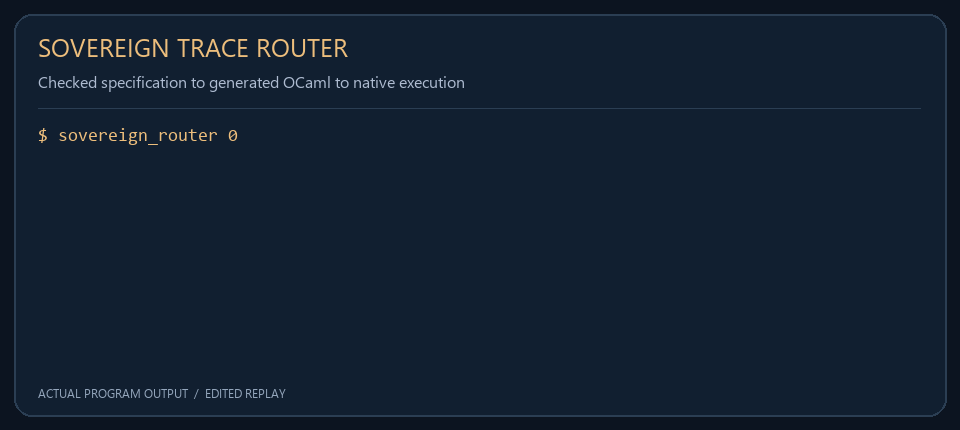
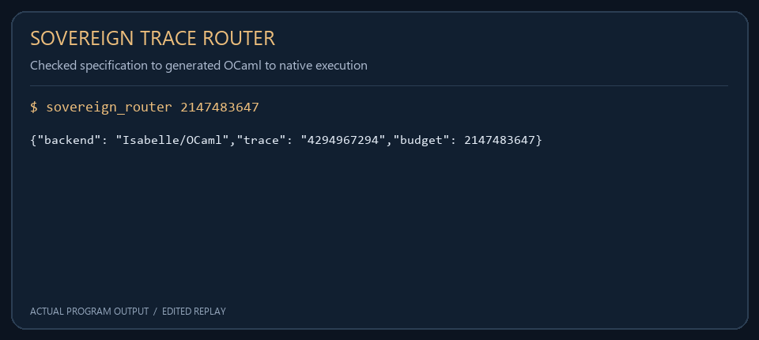

<div align="center">

# Sovereign Trace Router

**A checked trace specification, generated OCaml, and a native Objective-C execution path.**

Isabelle/HOL · OCaml/Zarith · Objective-C · C · AGC



<sub>Actual program output, rendered as a compact replay. Animation timing is edited.</sub>

</div>

---

Sovereign Trace Router carries a small mathematical function across an explicit language boundary. Isabelle/HOL defines the trace of an eight-component state as twice its real component. Code generation exports that function to OCaml. A registered OCaml closure is called from Objective-C, which validates its input and produces a JSON result.

The repository also contains a checked C reference and a self-contained Block II AGC assembly routine. These variants expose their own numeric contracts so a mathematical equation over unbounded integers is not confused with arithmetic on bounded machine words.

**Navigate:** [Architecture](#architecture) · [Quick start](#quick-start) · [Specification](#specification-and-extraction) · [Native interface](#native-interface) · [Numeric contracts](#numeric-contracts) · [Validation](#validation)

## Architecture


| Layer | Implementation | Role |
|---|---|---|
| Specification | `isabelle/Torus_Trace.thy` | Define the state, trace and scalar wrapper |
| Theorem checking | Isabelle2025-2 | Check the trace equations and nonnegativity result |
| Code generation | Isabelle OCaml export | Produce the compiled function's implementation |
| Exact arithmetic | OCaml and Zarith | Evaluate with arbitrary-precision integers |
| Native boundary | Objective-C and OCaml embedding API | Validate input and invoke the registered closure |
| Result handling | JSON output and optional append log | Return a structured trace record |

The C and AGC sources are parallel bounded variants. They are not used as an undisclosed replacement when the Isabelle extraction fails. The native build regenerates its OCaml implementation from the theory before linking the router.

## Quick start

### Requirements

| Tool | Purpose |
|---|---|
| Isabelle2025-2 | Theory checking and OCaml generation |
| OCaml, Findlib and Zarith | Compile and embed exact arithmetic |
| GCC | Compile the Linux native executable and C reference |
| GNUstep development libraries on Linux | Foundation implementation for Objective-C |
| Foundation on macOS | Native Objective-C framework |
| Python 3 | Run the native-interface regression tests |

With these tools installed:

```sh
git clone https://github.com/AHMADALIPARR/sovereign-router.git
cd sovereign-router
ISABELLE=/path/to/Isabelle2025-2/bin/isabelle sh build.sh
```

Then run the native router:

```sh
.build/sovereign_router 9959
```

Its structured result contains:

```json
{"backend":"Isabelle/OCaml","trace":"19918","budget":9959}
```

JSON key order is not significant. The trace is returned as a decimal string, preserving an explicit integer representation across the foreign-function interface. Running without arguments selects the example budget `9959`.

## Specification and extraction

The Isabelle record contains the real component `r` and seven imaginary components, `e1` through `e7`. The implemented trace is:

```text
state_trace(q) = r(q) + r(q)
              = 2 × r(q)
```

The scalar wrapper constructs a state whose imaginary components are zero, then applies the same trace function. The theory checks the doubling equation, the scalar-wrapper equation, and nonnegativity when the real component is nonnegative. The state record and trace function do not implement a general octonion multiplication library.

`build.sh` runs the `Sovereign_Trace` session and exports `Sovereign_Trace.Torus_Trace:code/TorusTrace.ocaml`. That output is copied to [extraction/TorusTrace.ml](extraction/TorusTrace.ml), compiled with Zarith, and linked with the registration wrapper in [ocaml/trace_export.ml](ocaml/trace_export.ml).

Treat the extraction file as generated code. To change the mathematical function, edit the theory and rebuild. Hand-editing the generated output would break the source-to-export provenance that this build is designed to preserve.

The theorem establishes a property of the HOL function. It does not automatically prove the Objective-C runtime, memory management, file system, compiler, or every behavior at the language boundary. Those parts have separate execution tests.

## Native interface

The Objective-C entry point accepts a nonnegative decimal budget, checks the supported range, converts it to a decimal string, and calls the registered `torus_trace_calc` closure. The wrapper parses the value with Zarith and enforces the same range before evaluating the generated function.

Passing an optional second argument appends a JSON result to a local ledger:

```sh
.build/sovereign_router 9959 trace-ledger.jsonl
```

Successful execution writes the record to standard output. Invalid input, backend failures, and ledger-write failures produce an unsuccessful exit status. The append file is a conventional local log; it has no claim to WORM storage, cryptographic sealing, or transactional coordination between multiple writer processes.

This interface evaluates and records the supplied trace budget. It does not implement a network packet router or a general scheduling policy. Its routing boundary is the handoff from the native caller to the generated trace backend and result output.

## Numeric contracts

Different representations have different ranges. The supported contracts are explicit:

| Interface | Input contract | Arithmetic/result |
|---|---|---|
| Isabelle specification | Mathematical integer | Exact doubling |
| Generated OCaml function | Zarith integer | Exact doubling |
| Objective-C executable | `0..2147483647` | Exact result within uint32 range |
| `calculate_torus_trace_checked` | Same checked range and a valid output pointer | Success flag plus result; rejects overflow |
| Legacy C function | Any uint32 value | Defined unsigned wrapping |
| AGC routine | Nonnegative fixed-point budget `0..8191` | TRACE and overflow STATUS |

The legacy C function remains available for callers that rely on unsigned C arithmetic. Use the checked function when the application needs the mathematical doubling contract without wraparound. On rejection, the checked function leaves the supplied output value unchanged.

## AGC routine

[agc/torus_trace.agc](agc/torus_trace.agc) defines its memory symbols, constants, arithmetic path, overflow path, and return path. It reads `BUDGET`, writes `TRACE`, and reports success with `STATUS=0`. Arithmetic overflow sets `STATUS=1` and clears `TRACE`.

With Virtual AGC's yaYUL assembler available:

```sh
(cd agc && yaYUL torus_trace.agc)
```

The source has been assembled with zero errors, zero warnings, and no multiply defined symbols. It is a callable assembly routine; a complete AGC executive or deployment image is outside this repository's interface. Emulator execution and physical AGC execution have not been validated.

## Validation

The checked build has been executed with Isabelle2025-2, OCaml 4.13.1/Zarith, and GNUstep on Linux. Validation covers the actual Objective-C-to-generated-OCaml path rather than only a separate reference function.

```sh
gcc -Wall -Wextra -Werror c/torus_trace.c test/trace_test.c \
  -o .build/trace_test
.build/trace_test
python3 test/router_test.py
```

The C suite checks zero, ordinary values, the upper valid boundary, overflow rejection, null output pointers, and 10,000 generated in-range inputs. Native-interface tests check exact traces, malformed and out-of-range arguments, appended records, and consistency between command output and the ledger.

The GitHub Actions workflow downloads a checksum-verified Isabelle distribution and defines the extraction, native-build, and regression steps. Hosted workflow completion should be checked independently of the local validation record. The macOS linking path is included, but the executed native validation used Linux/GNUstep.

<details>
<summary>View a compact boundary-output screenshot</summary>



Recorded command output and replay metadata are available in [capture.json](docs/media/capture.json).

</details>

## Project layout

```text
isabelle/ROOT                  Isabelle session definition
isabelle/Torus_Trace.thy        State, trace equations and code export
extraction/TorusTrace.ml        Generated OCaml implementation
ocaml/trace_export.ml           Registered decimal-string FFI wrapper
objc/Router.m                  Native command and JSON ledger handling
c/torus_trace.c                Checked and wrapping uint32 variants
c/torus_trace.h                C interface declarations
agc/torus_trace.agc             Complete bounded AGC routine
test/                          C and native-interface regression tests
docs/media/                    Small demos, diagrams and output captures
```

## License

See [LICENSE](LICENSE) for the repository's license terms.
