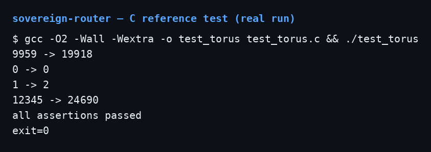
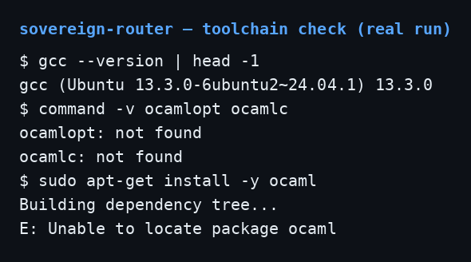

# Sovereign Router — Octonion Prime Trace Extraction (A_89/2462)

I built this repo around one function: the trace of an octonion. Take an
octonion state `q`, take its real part `Re(q)`, double it. That is the
whole computation:

```
t(q) = 2 * Re(q)
```

The repo implements that one function four ways — in C, in OCaml behind
an FFI boundary, in Objective-C driving the OCaml runtime, and in AGC
assembly for the Apollo Guidance Computer — so the same trace can be
computed on a modern host, across a verified-language boundary, and on
1960s flight hardware. The label A_89/2462 is the name I gave this
extraction. It is a project label, not a theorem name. Nothing in this
repo proves anything about a torus. The word "torus" in the file names
refers to the mapping this trace belongs to in the larger SnapKitty
work, and the mapping itself is not defined anywhere in this repo. I
am saying that up front because the old README implied more than the
code delivers. This README describes exactly what is here, what I ran,
and what I did not run.

## What is in the repo

| File | What it is |
|---|---|
| `c/torus_trace.c` | C reference implementation |
| `ocaml/trace_export.ml` | OCaml FFI wrapper, registers the named callback |
| `extraction/TorusTrace.ml` | Stand-in for the Isabelle extraction output — **not** Isabelle output |
| `extraction/README.md` | The Isabelle `export_code` command and the module-name trap |
| `objc/Router.m` | Objective-C router, boots the OCaml runtime and calls the callback |
| `agc/torus_trace.agc` | AGC core-rope fragment, same computation |
| `build.sh` | The three-step build: OCaml object, clang link, run |
| `docs/c-test.png` | Real screenshot of the C test run |
| `docs/toolchain-check.png` | Real screenshot of the toolchain check |
| `LICENSE` | SNAPKITTY OPAQUE SOURCE LICENSE v1.0 |
| `.gitignore` | Ignores `*.o`, `sovereign_router`, `trace_backend.o`, `.DS_Store` |

No source file sits loose at the root. Every source file lives in the
directory for its language or purpose. I checked for placeholder
metadata — `example@example.com`, `TODO`, `FIXME`, placeholder author
or maintainer lines — and found none. There are no `.cabal` or `mix.exs`
files in this repo, so there is no package metadata to fix. The module
names line up: `extraction/TorusTrace.ml` defines module `TorusTrace`
by filename, `ocaml/trace_export.ml` does `open TorusTrace`, and
`build.sh` references both files at their real paths.

## The one function

An octonion has eight components: one real part `r` and seven imaginary
parts `e1` through `e7`. The trace of an octonion is twice its real
part. The seven imaginary components do not contribute. Every
implementation in this repo does the same thing: add the real part to
itself.

I chose self-addition deliberately. `x + x` is one ALU add. It needs no
multiplier, no lookup table, and no floating point. On the AGC that
matters — the machine has no hardware multiply in the path this kernel
uses, and an add is the cheapest operation it has. On a modern host it
does not matter for speed, but keeping every implementation literally
the same operation means the four versions cannot drift apart in
behavior. If one of them ever computes something different, the bug is
visible immediately, because there is only one operation to compare.

The example budget used across the repo is 9959. The trace is 19918.
Every implementation that runs should print 19918 for that input.

## C reference: `c/torus_trace.c`

The file is 12 lines. It includes `<stdint.h>` and defines one
function:

```c
uint32_t calculate_torus_trace(uint32_t temporal_budget) {
    return temporal_budget + temporal_budget;
}
```

The input is called `temporal_budget`. It is the real component `r` of
the octonion, renamed for the execution-budget role it plays in the
router. The output is called the prime trace magnitude. The function
takes a `uint32_t` and returns a `uint32_t`. There is no validation,
no saturation, and no error return. Doubling a `uint32_t` wraps modulo
2^32. I verified this by execution: `3000000000` gives `1705032704`
(6,000,000,000 mod 2^32), and `4294967295` gives `4294967294`. For
budgets up to 2^31 - 1 the result is plain doubling with no surprise.
If you feed this function a budget above that range, know that it wraps
silently. That is the C semantics of unsigned addition, not a bug I
introduced, but it is a behavior you should know about before you pipe
its output anywhere that assumes the result is larger than the input.

The file has no `main`. It is a single function, meant to be linked
into something bigger or tested with a harness. The test harness I used
is not in the repo. I wrote it in `/tmp` for this verification run,
compiled it against the repo file, ran it, and deleted nothing from
the repo in the process. If you want a checked-in test, that is still
missing, and I list it under what is missing below.

## Demo: the C test, run on this machine

I compiled the C reference with gcc 13.3.0 on Ubuntu 24.04 (Linux) and
ran it. This is the exact output:

```
$ gcc -O2 -Wall -Wextra -o test_torus test_torus.c && ./test_torus
9959 -> 19918
0 -> 0
1 -> 2
12345 -> 24690
all assertions passed
exit=0
```

Four inputs, four correct outputs, plus assertions that the results
equal 19918, 0, 2, and 24690. Exit code 0. The harness also compiled
with `-Wall -Wextra` and produced no warnings.



## OCaml FFI wrapper: `ocaml/trace_export.ml`

This file is the bridge between the OCaml world and the Objective-C
world. It is 12 lines:

```ocaml
open TorusTrace

let trace_ffi (budget_scalar : int) : int =
  let state = { r = budget_scalar; e1 = 0; e2 = 0; e3 = 0;
                e4 = 0; e5 = 0; e6 = 0; e7 = 0 } in
  state_trace state

let () = Callback.register "torus_trace_calc" trace_ffi
```

Read it line by line. `open TorusTrace` brings in the module defined
by `extraction/TorusTrace.ml` — the octonion record type and the
`state_trace` function. `trace_ffi` takes one integer, builds an
octonion record with that integer as the real part `r` and all seven
imaginary parts set to zero, and calls `state_trace` on it. The last
line registers `trace_ffi` under the string name `"torus_trace_calc"`.
That string is the contract: the Objective-C side looks up exactly that
name. If the string changes on either side, the router fails at
runtime with the fatal log in `Router.m`. There is no compile-time
check linking the two sides. The name is the link.

Two things to notice. First, the wrapper hard-codes the imaginary parts
to zero. It does not accept a full octonion from the caller. The trace
only depends on `r` anyway, so this loses nothing for the trace, but
it means the FFI surface is one integer in, one integer out — not a
general octonion API. Second, the wrapper assumes the record type has
fields named `r`, `e1` through `e7`. That assumption comes from the
stand-in file. The real Isabelle extraction output will define
whatever record shape the Isabelle theory defines. If the real output
names its fields differently, this wrapper breaks and must be updated
to match. The stand-in and the wrapper agree today because I wrote
them to agree. The real extraction output has not landed, so that
agreement is provisional.

## The extraction stand-in: `extraction/TorusTrace.ml`

This is the file I most need you to read correctly. It is labeled in
its own header comment, and I repeat it here: **this file is an
assistant-written stand-in, NOT Isabelle/HOL output.** No Isabelle
theory exists in this repo. No `export_code` output exists in this
repo. Nobody has run Isabelle on this function in this repo. The
stand-in exists so the OCaml FFI and the Objective-C router can be
built and exercised before the real extraction lands.

What the stand-in contains: a record type and one function.

```ocaml
type octonion_state = {
  r : int;
  e1 : int; e2 : int; e3 : int; e4 : int;
  e5 : int; e6 : int; e7 : int;
}

let state_trace (s : octonion_state) : int =
  s.r + s.r
```

That is the whole file apart from the header comment. `state_trace`
adds the real part to itself, same as the C version. The imaginary
fields exist so the record has the shape of an octonion, but the
function never reads them.

Replacing this file with the real Isabelle output is the single most
important unfinished item in the repo. Until that happens, nothing in
this repo is formally verified, no matter what the old README implied.
The C version was verified by execution. The OCaml version was written
to match it. The Isabelle version does not exist yet. Those are three
different statements, and I keep them separate on purpose.

## The Isabelle command: `extraction/README.md`

The extraction README gives the command that produces the real file.
Run it in Isabelle, in the theory that defines `state_trace`:

```isabelle
export_code state_trace in OCaml
  module_name TorusTrace
  file "extraction/torus_trace.ml"
```

Then rename the output to `TorusTrace.ml` before building. This is not
cosmetic. OCaml derives a module's name from its filename. A file named
`torus_trace.ml` compiles to a module named `Torus_trace`, and
`trace_export.ml`'s `open TorusTrace` then fails with "Unbound module
TorusTrace". Isabelle writes the file lowercase. You must rename it
capital-T. The stand-in in this directory is already named
`TorusTrace.ml` for exactly that reason. This trap already bit once
during an earlier build attempt, which is why both the extraction
README and `build.sh` carry comments about it. I verified the
references are consistent: the filename is `TorusTrace.ml`, the
`open` says `TorusTrace`, and `build.sh` passes
`extraction/TorusTrace.ml` to the compiler. All three agree.

## Objective-C router: `objc/Router.m`

This is the host side. It is an Objective-C class,
`SovereignTraceRouter`, plus a `main`. It needs macOS and Foundation.
I did not compile it or run it on this Linux VM, and I am not going to
pretend otherwise. What follows is a reading of the code, not a test
report.

`init` boots the OCaml runtime inside the Objective-C process:

```objc
char *dummy_argv[2] = { "sovereign_router", NULL };
caml_main(dummy_argv);
NSLog(@"[+] OCaml formal verification runtime initialized.");
```

`caml_main` initializes the embedded OCaml runtime. The dummy argv
gives it a program name. The log line says "formal verification
runtime". That wording is aspirational: the runtime is the standard
OCaml runtime, and the code it runs is the stand-in until the real
extraction lands. The runtime does not make the code verified.

`routeExecutionTraceWithBudget:` does the call. It resolves the closure
by name:

```objc
const value *trace_closure = caml_named_value("torus_trace_calc");
if (trace_closure == NULL) {
    NSLog(@"[-] FATAL: Failed to resolve Isabelle/HOL closure 'torus_trace_calc'.");
    exit(EXIT_FAILURE);
}
```

If the name is not registered — because the OCaml side never ran its
`Callback.register`, or because the string does not match — the router
logs a fatal message and exits. There is no fallback and no retry. Then
it invokes the closure:

```objc
value result = caml_callback(*trace_closure, Val_int(budget));
NSInteger prime_trace = Int_val(result);
```

`Val_int` converts the C integer to an OCaml tagged integer.
`caml_callback` calls the registered OCaml function. `Int_val`
converts the result back. Then it logs the budget and the prime trace.

`main` creates the router and calls it once with budget 9959. The
expected trace is 19918. That is the entire program. It runs once,
prints two log lines, and exits.

What the router does not do: it does not pipe the trace to a Metal
bridge. The code has a comment saying "(Optional) Pipe prime_trace
directly to your objc-router/metal bridge". That is a comment, not
code. There is no Metal code in this repo, no bridge code, and no
pipeline after the log lines. The old README described the Metal pipe
as part of the flow. It is not. It is a TODO written as a comment, and
I am calling it that.

The router also has no input handling. The budget is hard-coded to
9959 in `main`. There is no argv parsing, no config file, and no way
to pass a different budget without editing the source. For a demo that
is fine. For a router, it is a limitation worth knowing.

## The build: `build.sh`

The build script is three steps:

```sh
ocamlopt -output-obj -o trace_backend.o extraction/TorusTrace.ml ocaml/trace_export.ml

clang -o sovereign_router objc/Router.m trace_backend.o \
      -I $(ocamlopt -where) \
      -L $(ocamlopt -where) -lasmrun -lm -ldl -fobjc-arc \
      -framework Foundation

./sovereign_router
```

Step 1 compiles the extraction file and the FFI wrapper into a native
object file with the OCaml runtime embedded. The file order matters:
`TorusTrace.ml` comes first so the module exists before
`trace_export.ml` opens it. Step 2 compiles the Objective-C router and
links it against the OCaml object, the OCaml runtime library, and
Foundation. Step 3 runs the resulting binary.

Step 1 needs OCaml. Step 2 needs macOS — clang alone is not enough,
because `-framework Foundation` is a macOS-only flag and `Router.m`
imports `<Foundation/Foundation.h>`. Step 3 needs the binary step 2
produced. On this Linux VM, step 1 cannot run because OCaml is not
installed (see the verification section below), and step 2 cannot run
because there is no macOS toolchain. The script is correct for a macOS
host with OCaml installed. It is not runnable here. The comments in
`build.sh` say this. I left them alone because they are accurate.

## AGC kernel: `agc/torus_trace.agc`

The AGC file is the same computation in Apollo Guidance Computer
assembly. It is a core-rope fragment, not a standalone program. Read
it that way.

The memory map puts the budget at erasable address `$0050` and the
trace ledger at `$0051`. These are 16-bit words. `EXTRACT_PRIME_TRACE`
does the work:

```
CA      BUDGET_REG              ; load R(q) into the accumulator
AD      BUDGET_REG              ; add R(q) again: t(q) = 2 * R(q)
TS      TRACE_LEDGER            ; store the trace to the ledger
TC      ADVANCE_STATE           ; jump to the advance routine
```

`CA` clears the accumulator and adds the budget. `AD` adds the budget
a second time. `TS` transfers the accumulator to the trace ledger.
`TC` transfers control to `ADVANCE_STATE`. Four instructions, same
computation as the C one-liner.

`ADVANCE_STATE` is the bookkeeping tail:

```
CS      ONE_CONSTANT            ; load -1 into the accumulator
ADS     LEDGER_POINTER          ; decrement available ledger space
TCF     EXECUTIVE_RETURN        ; return to the executive loop
```

`CS` loads the complement (negation) of a constant, `ADS` adds it to a
ledger pointer — effectively subtracting one from the remaining ledger
space — and `TCF` returns control to the executive.

Now the honest gaps. `ONE_CONSTANT`, `LEDGER_POINTER`, and
`EXECUTIVE_RETURN` are not defined anywhere in this file. There is no
`ORG` directive, no constant table, and no executive to return to. The
fragment assumes a supervisor mesh that provides those symbols and
that fills `BUDGET_REG` before jumping to `EXTRACT_PRIME_TRACE`.
Nothing in this repo writes `BUDGET_REG`. Nothing in this repo
defines the executive. On its own, this file does not assemble into a
runnable program — it is a routine that slots into a larger AGC
program that does not exist here.

I also never executed it. There is no AGC emulator on this VM, and I
did not install one. The AGC path is written, not run. The instruction
sequence is short enough to check by reading — `CA` then `AD` doubles
the value, `TS` stores it — but reading is not executing, and I do not
claim otherwise.

One more AGC detail: the accumulator is 16 bits. A budget that doubles
past 16 bits overflows silently, just like the C version wraps at 32
bits. The C, OCaml, Obj-C, and AGC versions all compute the same
mathematical function, but they do not share a word width, and their
overflow behavior differs. For the example budget 9959, all four agree
at 19918.

## What I verified, and what I did not

| Claim | Status | Evidence |
|---|---|---|
| C reference computes 9959 -> 19918 | Verified by execution | gcc 13.3.0, Linux, exit 0, assertions passed |
| C reference computes 0 -> 0, 1 -> 2, 12345 -> 24690 | Verified by execution | Same run |
| C reference wraps mod 2^32 on overflow | Verified by execution | 3000000000 -> 1705032704, 4294967295 -> 4294967294 |
| C compiles warning-free with `-Wall -Wextra` | Verified by execution | No warnings in the test build |
| OCaml `ocamlopt -output-obj` builds `trace_backend.o` | **Not verified this turn** | `ocamlopt` and `ocamlc` are not installed on this VM |
| OCaml toolchain present (previously reported as 4.14.1) | **False on this VM** | `command -v ocamlopt` prints "not found" |
| Installing OCaml via apt | **Failed** | `apt-get install ocaml` → "Unable to locate package ocaml"; mirrors unreachable |
| Obj-C router compiles and runs | **Not verified** | Needs macOS + Foundation; this VM is Linux |
| Obj-C router produces 19918 for budget 9959 | **Not verified** | Never compiled or run here |
| AGC kernel executes | **Not verified** | No AGC emulator on this VM |
| Isabelle extraction output exists | **Does not exist** | `extraction/TorusTrace.ml` is a labeled stand-in |
| Metal bridge / objc-router pipe | **Does not exist** | One comment in `Router.m`, no code |
| Module names and file paths consistent | Verified by inspection | Filename, `open`, and `build.sh` all say `TorusTrace` |
| No placeholder metadata in the repo | Verified by inspection | No `example@example.com`, `TODO`, or `FIXME` found |



The OCaml row deserves a longer explanation, because a previous note
on this repo said the OCaml step was verified by execution with
OCaml 4.14.1. On this VM, that is not true. `ocamlopt` is not
installed, `ocamlc` is not installed, and `apt-get install ocaml`
fails because the package lists have no such package and the mirrors
are unreachable. I tried. I did not fake the build, and I did not
claim it. The OCaml source files read correctly and their cross-file
references are consistent, but consistency on reading is not a build.
Until someone runs `ocamlopt -output-obj` on a machine with OCaml
installed, the OCaml step is unverified. If you have such a machine,
step 1 of `build.sh` is the command to run.

## Type widths across the four implementations

The four implementations do not share a word width, and this is the
one subtle thing in the repo:

- C: `uint32_t`, wraps mod 2^32. Verified.
- OCaml: `int`, which is 63 bits on a 64-bit platform (one tag bit).
  The OCaml version will not wrap where the C version does.
- Objective-C: `NSInteger`, 64 bits on 64-bit macOS, passed through
  `Val_int` into a 63-bit OCaml integer. A budget above 2^62 would
  not survive the crossing. The example budget 9959 is nowhere near
  that boundary.
- AGC: 16-bit accumulator. A budget above 32767 doubles past the word.

For any budget that fits in 16 bits, all four agree. For the example
budget 9959, all four agree at 19918. Outside that range, each layer
has its own overflow behavior, and the layers do not match each other.
If this trace ever carries real budget values near a word boundary,
the width mismatch is the first thing to fix — probably by narrowing
every layer to one agreed width and checking the input at the
boundary.

## Run it yourself

C reference, on any machine with gcc:

```sh
# Write a small harness (not in the repo) that includes the C file
# and calls calculate_torus_trace, then:
gcc -O2 -Wall -Wextra -o test_torus test_torus.c
./test_torus
```

Expect `9959 -> 19918`, `0 -> 0`, `1 -> 2`, exit 0.

Full build, on a macOS host with OCaml installed:

```sh
./build.sh
```

Expect the router to log a budget of 9959 and a prime trace of 19918.
If `ocamlopt` is missing, step 1 fails. If you are not on macOS, step
2 fails on `-framework Foundation`. Both failures are environmental,
not code bugs — but they are real failures, and on this Linux VM they
are exactly what happens.

## What is missing

I keep this list because the old README hid it:

1. The real Isabelle/HOL extraction output. The stand-in must be
   replaced with `export_code` output, renamed to `TorusTrace.ml`.
   Until then, nothing here is formally verified.
2. The Isabelle theory that defines `state_trace`. There is no
   `.thy` file in this repo, so there is nothing to run `export_code`
   against. The extraction README gives the command, but the theory
   it runs against does not exist here.
3. A checked-in C test harness. I tested with a harness in `/tmp`.
   The repo has no test file and no CI.
4. A macOS build report. `Router.m` has never been compiled or run
   as far as this repo's records show. The first macOS run should
   confirm the 19918 output and the log lines.
5. An AGC emulator run. The kernel is written, not executed.
6. The Metal bridge. One comment, no code.
7. Input handling in `Router.m`. The budget is hard-coded to 9959.
8. Definitions for `ONE_CONSTANT`, `LEDGER_POINTER`, and
   `EXECUTIVE_RETURN` in the AGC file, plus whatever writes
   `BUDGET_REG`. The fragment assumes a supervisor that is not here.
9. Any statement of what A_89/2462 means beyond the label. The repo
   uses the label everywhere and defines it nowhere.

None of these gaps make the code that exists wrong. The C function
does what it says. The OCaml wrapper does what it says. The AGC
fragment says what it does. But the gaps are the difference between
this repo and the repo the old README described, and I would rather
list them than let the next reader discover them.

## License

SNAPKITTY OPAQUE SOURCE LICENSE v1.0 — see `LICENSE`. Source is
readable, running it for research is permitted, commercial use needs
separate written authorization. I kept the license file untouched in
this rewrite.
